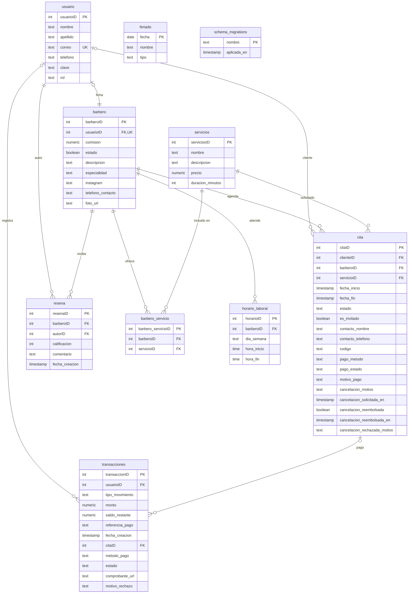

# Diagrama de la base de datos

Diagrama entidad-relación del esquema real de Spring Barber Shop, generado a partir de las 13 migraciones (`backend/migrations/000`–`012`) y verificado contra la base de datos PostgreSQL 18.6 en funcionamiento.

- `diagrama-base-datos.svg` — diagrama vectorial (se puede insertar en Word, PowerPoint o un navegador).
- `diagrama-base-datos.png` — misma imagen en 1940 × 1200 px.

## Resumen del modelo

| Elemento | Cantidad |
|---|---|
| Tablas | 10 (9 de negocio + `schema_migrations`) |
| Claves foráneas | 11 |
| Relaciones muchos-a-muchos resueltas | 1 (`barbero_servicio`) |
| Tablas sin relaciones | 2 (`feriado`, `schema_migrations`) |

## Diagrama (Mermaid)

## Relaciones verificadas

| # | Origen | Destino | Cardinalidad | Nota |
|---|---|---|---|---|
| 1 | `barbero.usuarioID` | `usuario.usuarioID` | 1 : 1 | `usuarioID` es único en `barbero` |
| 2 | `barbero_servicio.barberoID` | `barbero.barberoID` | 1 : N | tabla puente |
| 3 | `barbero_servicio.servicioID` | `servicios.serviciosID` | 1 : N | tabla puente |
| 4 | `cita.clienteID` | `usuario.usuarioID` | 1 : N | **admite nulo** (cita de invitado) |
| 5 | `cita.barberoID` | `barbero.barberoID` | 1 : N | obligatorio |
| 6 | `cita.servicioID` | `servicios.serviciosID` | 1 : N | obligatorio |
| 7 | `horario_laboral.barberoID` | `barbero.barberoID` | 1 : N | único por `(barberoID, dia_semana)` |
| 8 | `resena.barberoID` | `barbero.barberoID` | 1 : N | único por `(barberoID, autorID)` |
| 9 | `resena.autorID` | `usuario.usuarioID` | 1 : N | — |
| 10 | `transacciones.usuarioID` | `usuario.usuarioID` | 1 : N | **admite nulo** |
| 11 | `transacciones.citaID` | `cita.citaID` | 1 : N | **admite nulo** |

Restricciones únicas compuestas:

- `barbero_servicio (barberoID, servicioID)`
- `horario_laboral (barberoID, dia_semana)`
- `resena (barberoID, autorID)`

## Puntos que suele fallar un diagrama de este proyecto

1. **Nueve tablas en lugar de diez.** `schema_migrations` existe y es la que registra las migraciones aplicadas.
2. **`usuario` ↔ `barbero` dibujado como 1:N.** Es **1:1**, porque `barbero.usuarioID` tiene restricción única.
3. **Olvidar que `cita.clienteID` puede ser nulo.** Las reservas de invitado no tienen cuenta.
4. **Poner `resena` colgando de `cita`.** No existe `citaID` en `resena`: la reseña se vincula al barbero y al autor, y la restricción única impide más de una reseña del mismo cliente al mismo barbero.
5. **Dibujar `barbero` ↔ `servicios` como N:M directa.** Está resuelta con la tabla `barbero_servicio`.
6. **Poner `feriado` relacionada con `cita` o `barbero`.** No tiene claves foráneas; se consulta por fecha.
7. **Omitir `transacciones` o conectarla solo con `cita`.** Tiene dos claves foráneas anulables: `usuarioID` y `citaID`.
8. **Confundir el pago con una sola tabla.** El estado del pago se guarda tanto en `cita` (`pago_metodo`, `pago_estado`, `motivo_pago`) como en `transacciones` (comprobante, monto, estado).

> Para comparar con tu diagrama: revisa que aparezcan las 10 tablas, las 11 líneas de relación y las tres claves foráneas que admiten nulos (`cita.clienteID`, `transacciones.usuarioID`, `transacciones.citaID`).

